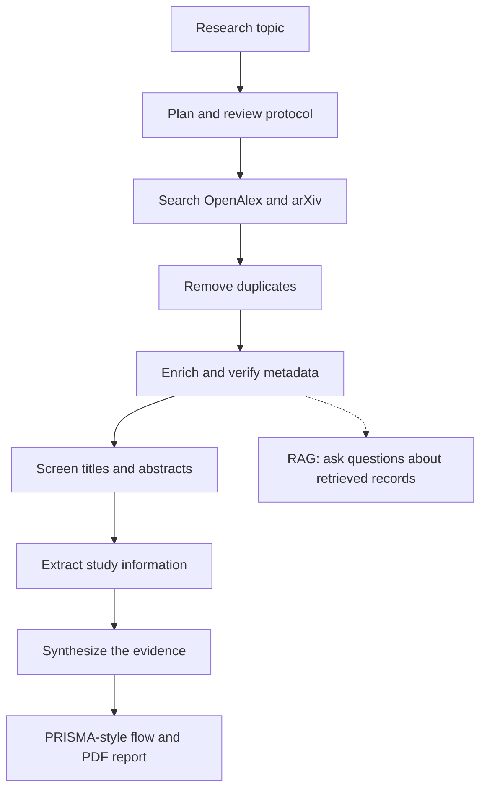

# Agentic AI for Systematic Literature Reviews

*A Python project developed for the M1 Agentic AI module*


## What I wanted to achieve

My main goals were to:

- Understand how to build and coordinate multiple AI agents.
- Apply this architecture to a real research workflow.
- Connect the system to scientific literature sources instead of relying only on an LLM's existing knowledge.
- Keep intermediate results so that I could inspect what happened at each step.
- Add checks for duplicate papers, screening decisions, and unsupported claims.
- Generate a readable report while keeping the limitations of automated research clear.

## Technologies used

| Tool / library | How I used it |
| --- | --- |
| Python 3.11 | Main programming language and development environment |
| LangGraph | Connecting the agents through a shared workflow state |
| LangChain and `langchain-ollama` | Working with local language models |
| Ollama | Running the models locally |
| `qwen3:4b` | Supporting protocol generation, screening, extraction, and synthesis |
| `nomic-embed-text` | Creating embeddings for the RAG component |
| OpenAlex | Searching for scientific publications |
| arXiv | Retrieving additional research papers and preprints |
| Crossref | Checking or enriching publication metadata where available |
| ChromaDB | Storing and retrieving embedded paper information |
| ReportLab | Creating the PDF report |
| JSON and CSV | Saving results and supporting manual review |
| VS Code | Writing, testing, and running the project |

The literature search needs an internet connection. The LLM runs locally through Ollama, so a paid cloud LLM API is not required for the main workflow.

## How the system works

The user starts by entering a research topic. LangGraph then executes the agents in sequence, with the results of each stage becoming input for the following stages.



### The main stages

**1. Planning**

The coordinator organizes the review into stages. This gives the workflow a clear sequence rather than calling different agents independently.

**2. Review protocol**

The protocol agent prepares a draft research objective, research questions, eligibility criteria, search keywords, and publication period. I added validation because the generated protocol needs to stay aligned with the user's topic. The protocol is still considered a draft until a researcher checks it.

**3. Searching for papers**

The search agents query **OpenAlex** and **arXiv**. Each retrieved record can contain information such as its title, authors, year, source, DOI, and abstract, depending on what the API provides.

**4. Removing duplicates**

Because the same article may appear in more than one source, the deduplication agent identifies repeated records before screening.

**5. Retrieving and checking metadata**

The retrieval and publication-verification components enrich available metadata and perform additional checks where possible. Missing metadata or a Crossref match should not be interpreted as proof that a paper is peer-reviewed.

**6. RAG component**

I also implemented a retrieval-augmented generation component using **ChromaDB**. It indexes information from retrieved papers and allows the system to generate an answer to a research question using relevant records. This is an additional feature of the workflow, not a substitute for reading the papers.

**7. Screening**

The screening agent evaluates titles and abstracts against the protocol and records provisional decisions. This is one of the most important steps to review manually, because a paper can look relevant from its title but still be outside the scope of the study.

**8. Evidence extraction**

The evidence-analysis agent tries to identify methods, datasets, evaluation metrics, findings, and limitations reported in the available abstracts. If an abstract does not provide enough detail, the system should not treat missing information as a confirmed result.

**9. Synthesis**

The reporting agents organize the extracted information and generate preliminary discussion sections. I used batched processing to handle larger groups of records rather than relying on one very long model request.

**10. Report generation**

The final stages prepare selection counts, a PRISMA-style diagram, and a PDF report. I also added separate scripts to validate a saved synthesis and regenerate the PDF without repeating the entire search.

The console groups these operations into ten numbered stages. Some supporting tasks, such as RAG and publication checks, are integrated into the wider workflow.

## Project structure

The most important files and folders are:

```text
agentic-ai-systematic-review/
│
├── agents/                         # Main research agents
│   ├── coordinator.py
│   ├── protocol.py
│   ├── multi_source_search.py
│   ├── search.py
│   ├── arxiv_search.py
│   ├── deduplication.py
│   ├── retrieval.py
│   ├── publication_verification.py
│   ├── screening.py
│   ├── evidence_analysis.py
│   ├── batch_synthesis.py
│   ├── review_reporting.py
│   ├── prisma_visualization.py
│   └── pdf_report.py
│
├── rag/                            # Document loading, vector store, retrieval, Q&A
├── data/
│   └── outputs/                    # Generated JSON, CSV, diagrams, and PDFs
│
├── main.py                         # Main entry point
├── workflow.py                     # LangGraph workflow and shared state
├── validate_scientific_synthesis.py
├── generate_validated_pdf.py
├── create_human_review.py
├── apply_human_review.py
├── test_*.py                        # Development and component tests
├── requirements.txt
├── .gitignore
└── README.md
```

There are also scripts used for debugging, regeneration, and specific experiments. For a new review, **`main.py` is the main entry point**.

## How I developed and tested it

I built the project progressively rather than implementing the whole workflow at once.

I first prepared the Python environment and checked that Ollama could answer requests from Python. Then I developed and tested the protocol, search, and deduplication components. Once those worked separately, I connected them using LangGraph.

The next part : screening and extracting useful information from abstracts. I added validation and saved intermediate JSON files because I wanted to see why a paper was included, what information was extracted, and whether the final synthesis was consistent with the earlier stages.

I then worked on the RAG component, report generation, PRISMA-style visualization, and post-processing scripts.

The repository contains several `test_*.py` scripts for individual components. These were used during development; they are not all part of one automated test suite, and some require live API access or Ollama.

### Topics used during testing

I tried the workflow with more than one topic, including:

- **Machine Learning for Fraud Detection: Techniques, Performance, and Challenges**
- **Explainable Artificial Intelligence for Credit Risk Assessment: Methods, Evaluation Metrics, and Challenges**

For example, one run on explainable AI for credit risk retrieved **140 records**. After removing **1 duplicate**, the system screened **139 records**, provisionally included **36**, and excluded **103**.

These numbers describe that particular execution only. They are not fixed outputs, and they do not mean that all 36 papers passed full-text eligibility checks. Some retrieved or included records still needed manual relevance verification.

Testing different topics helped me see that making a workflow configurable is not the same as guaranteeing equally good results for every topic.

## Installation and setup

The commands below are for **Windows PowerShell**, which I used during development.

### 1. Get the project

Clone the GitHub repository once it has been published:

```powershell
git clone https://github.com/YOUR-USERNAME/agentic-ai-systematic-review.git
cd agentic-ai-systematic-review
```

Alternatively, download the repository as a ZIP file and open its folder in VS Code.

### 2. Create a Python environment

I used **Python 3.11**.

```powershell
py -3.11 -m venv .venv
.\.venv\Scripts\Activate.ps1
```

Check the Python version:

```powershell
python --version
```

### 3. Install Python dependencies

```powershell
python -m pip install --upgrade pip
python -m pip install -r requirements.txt
```

The `requirements.txt` file lists the Python packages and their versions. It is separate from this README.

**Before publishing:** save `requirements.txt` as **UTF-8** and test the installation in a fresh environment. The archived dependency file was generated from a development environment and may contain more packages than are strictly necessary.

### 4. Install Ollama and download the models

Install Ollama from [ollama.com](https://ollama.com/), then run:

```powershell
ollama pull qwen3:4b
ollama pull nomic-embed-text
ollama list
```

Make sure Ollama is running. If it is not already started by the desktop application, use:

```powershell
ollama serve
```

The model downloads can take time. Running the project also requires enough memory for local inference.

## Configuration

The main settings are currently defined in the Python code.

**Research topic:** The program asks for the topic when it starts. It is better to use a clear and specific topic in English, especially because the protocol agent checks whether its generated questions match the input.

**Publication years:** In `workflow.py`, the protocol agent is configured with a range of **2022–2026**.

**Number of papers:** The search call in `workflow.py` uses `max_results=70` per source, allowing up to approximately **140 records** before deduplication, depending on the APIs. For a smaller test, this can be reduced. If this value is changed, the corresponding search-audit value in `main.py` should also be updated.

**Models:** The code uses `qwen3:4b` and `nomic-embed-text`. Changing models requires updating the relevant agent configuration and checking that the new models work with the expected outputs.

**Environment variables:** Keep any local `.env` file private. Do not upload it to GitHub.

## Running the project

With the virtual environment activated and Ollama running, execute:

```powershell
python main.py
```

The program will ask:

```text
Enter your research topic:
```

For example:

```text
Explainable Artificial Intelligence for Credit Risk Assessment: Methods, Evaluation Metrics, and Challenges
```

After that, the agents run through the workflow. The terminal displays progress, and intermediate results are saved under `data/outputs/`.

A full run may take time, especially when many papers are screened and analyzed by a local language model. The duration depends on the number of records, computer resources, model speed, and external APIs.

### Checking a saved synthesis

After the main workflow has produced its synthesis files, I can run:

```powershell
python validate_scientific_synthesis.py
```

This script checks and conservatively adjusts parts of a **saved** synthesis. It produces a separate validated JSON file and an audit, rather than treating every generated statement as automatically correct.

### Generating the PDF from saved results

```powershell
python generate_validated_pdf.py
```

This generates a preliminary PDF from the saved validated synthesis and related outputs. It does **not** run the literature search again. The necessary JSON files must already exist and must come from the same review.

### Preparing records for manual review

```powershell
python create_human_review.py
```

This prepares a CSV for records marked **uncertain** during screening. Human decisions can be handled using the related review script after the CSV has been completed.

## Outputs

Most results are saved in `data/outputs/`. Some examples are:

| Output | What it contains |
| --- | --- |
| `review_protocol.json` | Generated research questions and review criteria |
| `retrieved_papers.json` | Paper records collected or enriched during the run |
| `search_audit.json` | Search settings, source counts, and timestamp |
| `deduplication_result.json` | Unique papers and duplicate counts |
| `screening_results.json` | Provisional screening decisions |
| `evidence_results.json` | Extracted information from available abstracts |
| `synthesis_report.json` | Preliminary synthesis |
| `quality_assurance.json` | Quality checks and reported limitations |
| `prisma_preliminary.json` | Preliminary study-selection counts |
| `prisma_flow.png` | PRISMA-style flow diagram |
| `systematic_review_preliminary.pdf` | Initial PDF report |
| `systematic_review_preliminary_validated.pdf` | PDF generated from saved validated evidence, when available |

Not every file is created by every command. Some are produced by later validation or regeneration scripts.

## Project submission

This repository is part of my **M1 Agentic AI coursework**. The submission includes the source code and this README, together with a short video demonstration and a final report describing the project and the individual contributions.

**Final note:** Through this project, I had the opportunity to put into practice the concepts covered in the Agentic AI module. I worked on connecting different AI agents to automate several steps of a systematic literature review, from searching for papers to generating the final report. During the development and testing, I also faced some challenges, especially with the accuracy of the results and the consistency of the generated reports. This experience helped me better understand how agentic AI systems work in practice, as well as their limitations and the importance of human verification in scientific research.
